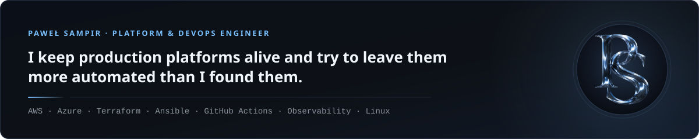

<picture>
  <source media="(prefers-color-scheme: dark)" srcset="assets/banner-dark.svg">
  <source media="(prefers-color-scheme: light)" srcset="assets/banner-light.svg">
  
</picture>

Three years in platform engineering and DevOps on enterprise web platforms (**AWS**, **Azure**, **Terraform**, **Ansible**, **GitHub Actions**, **Prometheus / Grafana / Loki / New Relic**, **Cloudflare**). Most of my day job lives in private repositories — this profile is where my homelab infrastructure, self-hosted applications and developer tooling live.

### Infrastructure & Homelab
- **[home-server-provisioner](https://github.com/psampir/home-server-provisioner)** — the Ansible repo behind my Debian lab: system hardening, hub-and-spoke WireGuard + dnsmasq, Caddy, Docker Compose stacks, Gatus monitoring, and append-only borgmatic backups tested against Incus VMs.

### Self-Hosted & Desktop Apps
- **[shept](https://github.com/psampir/shept)** — local speech-to-text for Linux desktops (`GTK4` / `libadwaita` frontend for `whisper.cpp` with Silero VAD and a self-contained Flatpak bundle).
- **[choruko](https://github.com/psampir/choruko)** — self-hosted household app for chores, points and expense settlements (`React 19`, `ASP.NET Core 10`, `PostgreSQL`, Docker/GHCR).

### Developer Tooling & MCP
- **[dietly-mcp](https://github.com/psampir/dietly-mcp)** — MCP server (Streamable HTTP & stdio) and CLI for automating meal selection on Dietly, with dry-run previews, an append-only audit log, one-step reverts and a GHCR container image.
- **[vicinae-color-picker](https://github.com/psampir/vicinae-color-picker)** — Wayland screen color picker extension for the Vicinae launcher (`TypeScript`).
- **[hzstrobe](https://github.com/psampir/hzstrobe)** — zero-dependency Canvas 2D utility for monitor refresh-rate detection and strobe testing ([live demo](https://psampir.github.io/hzstrobe/)).
